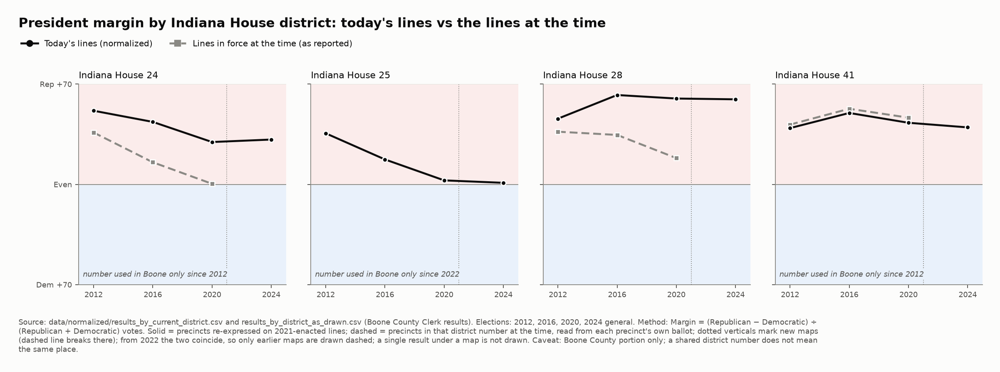
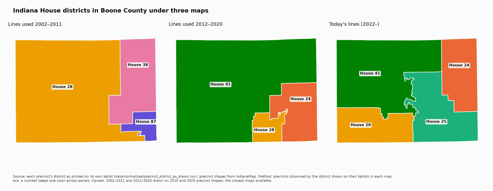

# Boone County, Indiana — Precinct-Level Election Results, 2008–2026

Precinct-level election results for **Boone County, Indiana**, parsed from the Boone County
Clerk's official result reports. Covers every election the Clerk publishes from 2008
onward: primaries, generals, odd-year municipal elections, and specials, at every level
the Clerk reports (federal, state, county, municipal, township, school board, judicial
retention, and public questions).

Every number comes from a Clerk PDF in `source_pdfs/` and was extracted by a script in
`scripts/`. Nothing was typed by hand, estimated, or taken from another source.

It also includes a **normalized** layer: every election's results re-expressed on the
current (2021-enacted) Indiana House, Indiana Senate and U.S. House districts, so each
district's history can be compared on today's lines. That layer is kept separate from
the master (`data/normalized/`) and documented in METHODOLOGY.md §7.

**Interactive map:** <https://olivergollapudi.github.io/boone-county-indiana-election-data/>
— choose a contest and year, view precincts as reported or today's districts, and hover
any area to see the results rows it is built from.

## Why normalize: a district number is not a place

Boone County's district lines were redrawn for 2012 and again for 2022, and district
numbers were reused for different areas. Charting "House 28" over time with the results
as reported mixes three different places. The chart below compares each House district
number using the lines in force at the time (dashed) with the same number on today's
lines (solid):





More maps, each with its caption (source, election, method, caveat), are in
[`maps/`](maps/): precinct margins for President, Governor and U.S. Senate; each
current district's trend; every precinct's presidential trend 2012→2024; precinct
swing maps for 2012→2024 and 2016→2024; 2024 turnout; and the same comparison for
Senate and congressional districts.

## At a glance

| | |
|---|---|
| Source | Boone County Clerk, "Election Results History" (`boonecounty.in.gov/offices/clerk/election-results-history/`) |
| Elections | 28 (2008 primary through 2026 primary) |
| Result rows | 51,879 (one row per election × contest × precinct × candidate) |
| Turnout rows | 1,245 (one row per election × precinct) |
| Validation | 20,670 single-winner contests checked; 0 failures |

## Files

```
data/              the published database (start here)
data/normalized/   results on today's districts, and as drawn at the time (analysis layer)
maps/              static maps and charts (PNG) with captions
site/              the interactive map (static page + data; published to GitHub Pages)
source_pdfs/       the Clerk's original reports — every row traces back to one of these
source_geo/        precinct maps and Census blocks used for normalization (Boone only)
ocr_cache/         cached OCR output for the two scanned reports
scripts/           the pipeline that turns source_pdfs/ into data/
docs/              technical notes
```

| File | What it is |
|---|---|
| `data/boone_county_election_results.xlsx` | The assembled database: README, Results_Long, Turnout_Long, Precincts, Source_Provenance, Validation, Coverage_Inventory |
| `data/results_long_all.csv` | Results for the 25 text-based (embedded) elections |
| `data/results_long_2008-general-precinct-geom-clean.csv`, `data/results_long_2022-primary-precinct-geom-clean.csv` | Results for the two scanned elections. Only contests that reconcile exactly are included |
| `data/omitted_*.csv` | Contests from the scanned elections that could not be reconstructed exactly, so they were left out. Each one is listed with its reported total |
| `data/turnout_long.csv` | Per-precinct registered voters, ballots cast, turnout %, and ballot-type counts |
| `data/precinct_crosswalk.csv` | Current precincts with their town and county council district |
| `data/normalized/results_by_current_district.csv` | Every election's results on today's House, Senate and congressional districts (Boone County's portion) |
| `data/normalized/results_by_district_as_drawn.csv` | The comparison baseline: every election's results by the districts in force at the time (from each precinct's ballot) |
| `data/normalized/precinct_district_shares.csv` | How each precinct was split across today's districts |
| `data/normalized/normalization_validation.csv` | The five normalization checks and their results |
| `data/normalized/current_districts.geojson` | Today's district outlines within Boone County |
| `source_geo/` | Boone precinct maps (2000–2024, from IndianaMap) and Census 2010/2020 blocks, with `SOURCES.csv` provenance |
| `source_pdfs/*.pdf` | The Clerk's source reports (`*-precinct.pdf` = precinct breakdown, `*-summary.pdf` = countywide summary) |
| `ocr_cache/*.json` | Cached OCR output for the scanned reports, so the pipeline can be rerun without macOS |
| `scripts/*.py` | The pipeline (see below). `scripts/paths.py` defines the folder layout |
| `METHODOLOGY.md` | How the data was built and validated, in plain English |
| `docs/PARSING_STRATEGY.md` | Technical spec of the report formats and how the parser handles each one |

Every column of every table is defined in [DATA_DICTIONARY.md](DATA_DICTIONARY.md).

## How it was validated

Each Clerk report prints a total for every contest (`VOTES=`). A contest is included only
if its candidate totals add up exactly to that printed total. For the six elections where
the Clerk also publishes a separate countywide summary, the precinct rows were also summed
and checked against that summary, candidate by candidate, with zero mismatches.
Multi-seat contests can't use the single-winner check. See `METHODOLOGY.md` for how they
were handled.

The normalized layer has its own checks, and `scripts/normalize.py` refuses to write
output if any fail: every vote is conserved (allocated + set aside = source, for every
election, contest and candidate), and the district printed on each precinct's own ballot
matches the map for all 630 checks from 2022 onward.

## Known issues (being fixed)

- **Labels in the two scanned elections (2008 general, 2022 primary).** Some contests
  there add up correctly but have a missing candidate name, a printed percentage that
  disagrees with the vote count, or a vote count misread as the office title (roughly 8%
  and 25% of included contests). A label check that removes them is being finalized.
  Until then, don't draw candidate-level conclusions from these two elections; their
  normalized rows are marked `data_quality = ocr_labels_unverified`.
- **2008 general is not yet reproducible from the current code.** The published file
  came from an earlier version of `geometry_parse.py`; rerunning today's code gives the
  same candidate totals for nearly all rows but different vote-method splits on about 90
  rows and 3 extra rows. This will be resolved with the label fix.

## Known gaps

- **2008 primary:** the Clerk published only a countywide summary, so this election is
  countywide only.
- **2008 general and 2022 primary:** the source reports are scans. Contests that could
  not be reconstructed exactly are excluded and listed in `data/omitted_*.csv`.
- **2020 primary:** the Clerk's reports print registered voters and turnout % as zero
  for 49 of 53 precincts. Ballots cast are still recorded. (The 2020 general is complete.)
- **2026 general:** not yet included. It will be added after the county certifies results.

## Rebuild from source

Requires Python 3.11+. Run from the repository root, in this order:

```bash
python3 -m venv .venv && source .venv/bin/activate
pip install -r requirements.txt
python3 scripts/parse_all.py         # parse the 25 text-based elections -> data/results_long_all.csv
python3 scripts/reconcile_all.py     # cross-check against countywide summaries (expect 0 mismatches)
python3 scripts/geometry_parse.py 2008-general-precinct   # rebuild scanned tables from cached OCR boxes
python3 scripts/geometry_parse.py 2022-primary-precinct
python3 scripts/finalize_ocr.py 2008-general-precinct     # keep only reconciling contests
python3 scripts/finalize_ocr.py 2022-primary-precinct
python3 scripts/extract_turnout.py   # -> data/turnout_long.csv
python3 scripts/add_center1.py       # add 2008 precinct Center 1, which the Clerk published separately
python3 scripts/build_workbook.py    # -> data/boone_county_election_results.xlsx
python3 scripts/normalize.py         # -> data/normalized/ (stops if any check fails)
python3 scripts/as_drawn.py          # -> data/normalized/ comparison baseline (stops if any check fails)
python3 scripts/make_maps.py         # -> maps/
python3 scripts/build_site.py        # -> site/data/ for the interactive map (stops if any check fails)
```

To view the interactive map locally: `python3 -m http.server --directory site`, then open
<http://localhost:8000>.

`scripts/prepare_geo.py` rebuilds `source_geo/` from the IndianaMap layers and Census
downloads; it only needs to run if those inputs change.

`add_center1.py` must come after `finalize_ocr.py` and `extract_turnout.py`, because
those two rewrite the files it adds to. Intermediate files go to `build/`, which is not
published.

Rerunning OCR from the PDFs (`scripts/dump_boxes.py`) requires macOS because it uses
Apple Vision. Every other step runs on any platform from the cached JSON files.

## License

| What | License |
|---|---|
| **Data, maps and documentation:** `data/`, `maps/`, `site/data/`, `source_geo/` (as compiled here), and the `.md` files | [CC0 1.0](LICENSE-DATA): dedicated to the public domain. Use it for anything, no permission needed. Credit is appreciated (see the citation file) but not required. |
| **Code:** `scripts/`, `site/index.html`, `.github/` | [MIT](LICENSE) |

Third-party material in this repository, which these licenses do not cover:

- **`source_pdfs/`**: the Boone County Clerk's official result reports, public records,
  reproduced unchanged.
- **Census blocks** (in `source_geo/`): U.S. Census Bureau TIGER/Line and P.L. 94-171
  data, public domain.
- **Precinct shapes** (in `source_geo/` and `site/data/`): from IndianaMap / gisdata.in.gov.
  The 2010 and 2020 layers are derived from Census voting districts (public domain). The
  2023 and 2024 layers come from the Indiana General Assembly; their item pages state no
  license. Provenance for every input is in `source_geo/SOURCES.csv`.
